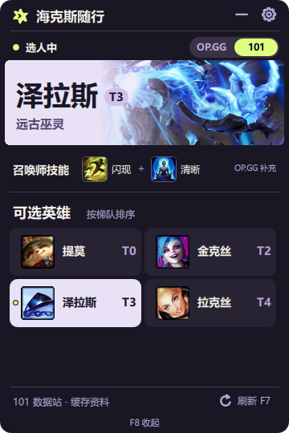
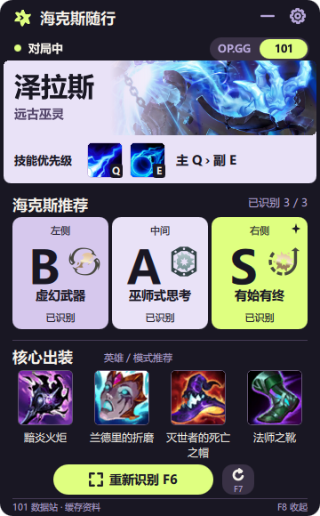
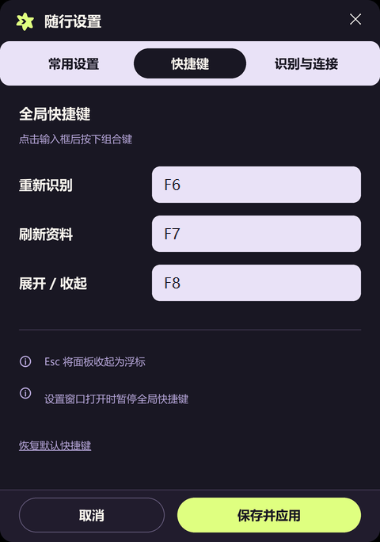

<p align="center"></p>

# 海克斯随行 · Hex Companion

一款以轻量化、低资源占用为设计目标的 Windows 英雄联盟海克斯大乱斗浮窗助手。用一个紧凑浮窗，在选人时查看英雄梯队，在局内查看海克斯评级与模式出装参考。

采用原生桌面界面，资料按需获取、图标本地缓存；OCR 只处理三张海克斯的标题区域，重复画面复用识别结果。平时驻留托盘，进入海克斯模式后显示，需要时可收起为小浮标，减少屏幕占用。

## 界面预览

以下为程序实际界面的模拟对局预览，英雄与装备使用本地 OP.GG 快照。

<table>
  <tr><th>选人：英雄梯队</th><th>局内：海克斯与装备</th><th>设置：自定义快捷键</th></tr>
  <tr>
    <td valign="top"></td>
    <td valign="top"></td>
    <td valign="top"></td>
  </tr>
</table>

收起后保留可拖动小浮标，单击或按快捷键展开：

## 功能

- **轻量化优先**：原生桌面浮窗、局部 OCR、重复画面复用与本地缓存，减少重复识别和网络请求。
- **选人浮窗**：显示已选英雄与客户端返回的可选英雄，按 OP.GG 的 T 档和排名排序。
- **海克斯评级**：OCR 识别左、中、右三张增幅装置，显示当前英雄对应的 S / A / B / C / D / E 档位。
- **核心出装与图标**：只显示海克斯大乱斗页面的三件核心成装与一双鞋，保留来源顺序；装备图标本地缓存。
- **可拖动浮标**：收起后变为小浮标，单击展开；面板和浮标均可拖动。
- **自定义快捷键**：默认 F8 展开 / 收起，在设置里修改识别、刷新和浮窗快捷键，保存后立即生效。
- **后台运行**：系统托盘管理，切出联盟或离开海克斯模式时隐藏；支持对局已经开始后启动。
- **本地识别与缓存**：只识别三个标题区域，重复画面复用结果，识别完成后原位更新卡片。

## 直接使用

从本仓库的 [Releases](https://github.com/haixianma422-maker/hex-companion/releases) 下载 Windows x64 发布包，解压后运行 `HexCompanion.exe`。需要 Windows 10/11 x64，无需安装 Python。

1. 退出旧版工具，双击 EXE 并确认 Windows 管理员权限提示。
2. 将游戏视频设置中的窗口模式设为 **无边框**。桌面浮窗可能被独占全屏遮住。
3. 进入海克斯大乱斗；工具启动后先驻留系统托盘，在对应模式中自动显示浮窗。
4. 首次识别位置不合适时，打开“设置 → 识别与连接”，调整三个标题区域。
5. 右键托盘图标可打开设置或退出程序。

| 操作 | 效果 |
| --- | --- |
| F6 | 强制重新识别；取消手动修正的保留状态 |
| F7 | 刷新英雄榜、当前英雄资料及客户端状态 |
| F8 | 在展开面板与小浮标之间切换 |
| Esc / 收起 | 将面板收起为可拖动小浮标 |
| 单击浮标 | 展开面板 |

EXE 的设置和更新缓存保存在 `%LOCALAPPDATA%\HexCompanion\data`。获取新资料需要能够访问 OP.GG；已有缓存和内置 OCR 模型可离线使用。

在“设置 → 快捷键”中点击输入框后按下组合键，或填写 `F8`、`Ctrl+Alt+H` 等形式。重复、无效或已被其他程序占用的组合会提示错误，并保留原设置；设置窗口打开期间暂停全局快捷键。

## 数据来源

| 内容 | 来源与处理方式 |
| --- | --- |
| 英雄 T 档 | [OP.GG 海克斯大乱斗英雄榜](https://op.gg/zh-cn/lol/modes/aram-mayhem)，同档按来源排名排序 |
| 海克斯评级 | 对应英雄的 `/augments` 页面；原始 tier 0～5 映射为 S～E，见 [映射核对记录](data/tier_mapping_evidence.json) |
| 模式出装 | 对应英雄的 `/build` 页面，写入前校验 Mayhem 路径、页面标题和模式标记 |
| 装备筛选 | Riot 装备元数据，见 [装备目录](data/item_catalog.json) |
| 装备图标 | Riot [Data Dragon](https://support-developer.riotgames.com/hc/en-us/articles/22698698001939-League-of-Legends) 静态资源，按装备 ID 缓存；已有快照对应的图标随 EXE 提供 |
| 中文分类标签 | CommunityDragon 中文游戏文本中的标签定义，见 [标签快照](data/augment_display_tags.json) |

首次进入对应模式时更新英雄榜，选中英雄时按需更新详情；F7 可手动刷新。网络失败时保留已有缓存。数据文件记录来源、抓取时间与来源版本，OP.GG 的版本和统计样本可能与国服不同。

出装按**英雄与海克斯大乱斗模式**提供，不根据已选海克斯动态配装。从主出装页的首组核心中按来源顺序取前三件成装，过滤散件，并取首双推荐鞋子。资料不足时保留空位，不补充后续装备。新英雄缺失的图标在后台按需获取，下载失败时保留装备名称，可按刷新快捷键重试。

随仓库提供英雄梯队和经过模式校验的部分英雄详情快照。客户端连接凭据仅用于本机状态读取；标题截图在内存中处理。工具不代替用户选人或操作游戏。

## 源码运行

使用 Windows 与 Python 3.13。从仓库根目录运行：

```powershell
py -3.13 -m venv .venv
.\.venv\Scripts\python.exe -m pip install -r requirements.txt
.\start_companion.cmd
```

也可双击 `setup_demo.cmd` 安装依赖，再启动工具。联盟以管理员权限运行时，使用 `start_companion_admin.cmd`；该入口会请求 Windows 权限确认。

不开联盟查看界面：

```powershell
.\preview_companion.cmd
```

预览可切换选人与局内样式，使用本地缓存，标注“模拟预览”。源码版的设置与缓存写入项目的 `data` 目录。

## 测试与打包

自动测试：

```powershell
.\.venv\Scripts\python.exe -X utf8 -m unittest discover -s tests -v
```

构建单文件 EXE：

```powershell
.\.venv\Scripts\python.exe -m pip install -r requirements-build.txt
.\.venv\Scripts\python.exe scripts/build_exe.py
```

成品位于 `dist/HexCompanion.exe`，包含 Python、OCR 模型及通过模式校验的初始快照。正常启动会请求管理员权限。

对实际 EXE 执行离线验收，并生成分享包：

```powershell
.\dist\HexCompanion.exe --self-test artifacts/packaged_desktop_check.json
# 等待上一步生成 status=passed 的报告后运行：
.\.venv\Scripts\python.exe scripts/package_release.py
```

验收覆盖离线中文 OCR、初始数据、托盘、浮窗、浮标、缓存读写和退出。它会短暂打开测试界面，不连接真实对局。分享包输出到项目的上一级目录，依赖许可证随发布包提供。

## 常见问题

**已经进入对局，但看不到浮窗**

先切换为无边框模式，并将联盟置于前台。在托盘打开“设置 → 识别与连接”检查状态；已核实 `InProgress · 队列 2400` 可以在对局中启动。独占全屏下曾出现浮窗被遮挡，切换无边框后恢复。

**客户端连接失败**

EXE 启动时确认管理员提示。源码版使用管理员入口，必要时在设置里选择包含 `LeagueClient.exe` 或 `LeagueClient` 子目录的安装位置。目前识别匹配队列 `2400` 与国服自定义海克斯队列 `3270`，普通大乱斗 `450` 不触发。

**部分海克斯显示待确认**

按 F6 重识别，或调整三个标题区域。也可在设置里手动选择选项。OCR 无法确定名称时保留待确认状态；手动修正后按 F6 恢复自动识别。

**如何更新本地元数据**

`scripts/refresh_data.py` 更新 OP.GG 英雄榜与指定英雄；`scripts/sync_item_catalog.py --patch 版本号` 更新装备目录；`scripts/audit_augment_tags.py` 检查中文标签快照。以上脚本支持 `--help`。`scripts/sync_item_icons.py` 下载已校验英雄快照对应的装备图标，`scripts/export_demo_images.py` 重新生成上方模拟预览截图。

## 目录

```text
aram_demo/       客户端连接、OCR、数据处理和桌面浮窗
data/           可共享的数据快照；个人 settings.json 被忽略
docs/images/    选人、局内、快捷键设置和浮标演示图片
scripts/        数据更新、界面验证、EXE 构建与验收
tests/          自动测试
packaging/      图标、使用说明和第三方依赖说明
app.py          启动入口
```

## 许可证

本项目原创代码和文档采用 [MIT License](LICENSE)，版权归 haixianma422-maker 所有。

第三方依赖、OCR 模型、OP.GG 统计快照、Riot Games 游戏文本及图标等资源，适用各自的许可证或服务条款。来源与许可说明见 [第三方组件说明](packaging/THIRD_PARTY.txt)；Windows 发布包中的 `licenses/` 目录提供依赖许可证文本。
